# BiciPuntos: análisis y diseño técnico

23 de noviembre de 2026 · Evidencia 2 · Tecnólogo en Análisis y Desarrollo de Software (ADSO), SENA

BiciPuntos es una app móvil para que los ciclistas de la Avenida Boyacá encuentren talleres, puntos de hidratación, comida e información. Este documento la analiza y la diseña a partir de `puntos.mock.js`, sin escribir código, para que otro desarrollador pueda construirla sin inventar procesos ni estructura.

## Mapa de entregables

Los 12 entregables obligatorios del taller están en este documento, en el orden de las fases de la guía.

| # | Entregable de la guía | Sección |
| --- | --- | --- |
| 1 | Análisis de `puntos.mock.js` y diccionario de datos | 1 |
| 2 | Requerimientos funcionales y no funcionales | 2 |
| 3 | Descripción de la arquitectura propuesta | 3 |
| 4 | Estructura de carpetas y responsabilidad de cada capa | 3 y 3.1 |
| 5 | Inventario de hooks | 3.2 |
| 6 | Inventario de componentes y árbol jerárquico | 3.3 |
| 7 | Diagramas de comunicación padre-hijo e hijo-padre | 4 |
| 8 | Lógica de negocio y reglas de validación | 5 |
| 9 | Diagramas de procesos y secuencias | 4, 5 y 7 |
| 10 | Mockups de las pantallas principales | 6 |
| 11 | MVP y matriz MoSCoW | 8 |
| 12 | Plan de implementación por etapas | 9 |

No hay código ejecutable en ningún entregable: la lógica se describe con tablas, pseudocódigo y diagramas, como pide la regla principal del taller.

## 1. Análisis de la materia prima

`puntos.mock.js` simula la respuesta de un servicio REST: un sobre con el resultado de la consulta y, dentro, 15 puntos de interés ubicados a lo largo de la Avenida Boyacá en Bogotá.

**Lo que se encontró al revisar el archivo**

| Categoría (valor en el archivo) | Etiqueta para mostrar | Icono | Puntos | ids |
| --- | --- | --- | --- | --- |
| `taller` | Taller | 🔧 | 4 | 1, 6, 9, 13 |
| `hidratacion` | Hidratación | 💧 | 4 | 2, 5, 10, 15 |
| `comida` | Comida | 🍎 | 4 | 3, 7, 11, 14 |
| `informacion` | Información | ℹ️ | 3 | 4, 8, 12 |

- Las categorías vienen en minúsculas y sin tilde: la app necesita un catálogo que las traduzca a una etiqueta legible.
- El icono se repite igual en todos los puntos de una categoría, así que depende de ella y puede salir del mismo catálogo.
- Todas las coordenadas están en Bogotá: latitud de 4.60975 a 4.73835 y longitud de -74.1327 a -74.0707. Los ids van de sur a norte.
- `referencia` sigue un patrón genérico: "Avenida Boyacá · sector de referencia N", donde N es el id.
- Ningún punto tiene campos vacíos. Las reglas para datos faltantes son preventivas, pensando en la API real.
- El archivo es un módulo JavaScript (`export const respuestaMock`), no un `.json` puro, pero su contenido tiene forma de JSON.

**Respuestas a las preguntas de análisis**

| # | Pregunta | Respuesta |
| --- | --- | --- |
| 1 | ¿Qué representa `respuestaMock`? | La respuesta completa que devolvería el servicio de consulta de puntos: un sobre con el resultado de la operación y los datos. |
| 2 | Diferencia entre `status`, `mensaje`, `error` y `data` | `status` dice si la consulta funcionó (booleano); `mensaje` lo explica en texto; `error` trae el detalle cuando falla (`null` si no); `data` es el contenido: los puntos. Los tres primeros describen la operación, `data` es el negocio. |
| 3 | ¿Qué almacena `data`? | Un arreglo de objetos; cada objeto es un punto de interés. |
| 4 | ¿Cuántos registros hay? | 15. |
| 5 | ¿Qué atributos tiene cada punto? | 7: `id`, `nombre`, `categoria`, `icono`, `descripcion`, `ubicacion` y `referencia`. |
| 6 | ¿Qué agrupa `ubicacion`? | Las coordenadas geográficas: `lat` (latitud) y `lng` (longitud), en grados decimales. |
| 7 | Atributos para el mapa | `ubicacion.lat` y `ubicacion.lng` para la posición, `id` como llave del marcador, `categoria` e `icono` para su aspecto y `nombre` como título. |
| 8 | Atributos para tarjeta o detalle | Tarjeta: `icono`, `nombre`, `categoria` y `descripcion` resumida. Detalle: todo lo anterior más `descripcion` completa, `referencia` y coordenadas. |
| 9 | ¿Qué identifica un registro? | `id`: es numérico y único (1 a 15). |
| 10 | Campos para buscar o filtrar | `categoria` para el filtro principal; `nombre`, `descripcion` y `referencia` para una búsqueda por texto en una versión posterior. |
| 11 | ¿Y si un punto no tiene descripción? | Sigue siendo válido (el campo es opcional). Se muestra "Sin descripción disponible". |
| 12 | ¿Y si no tiene coordenadas? | No se puede ubicar en el mapa: se excluye de los marcadores, pero sigue en la lista con el aviso "Ubicación no disponible". |
| 13 | Estructura general vs. estructura de un punto | La general es el sobre de la respuesta (uno por consulta, con metadatos). La de un punto es la entidad del negocio (15, todos iguales). El servicio interpreta el sobre; los componentes solo trabajan con puntos. |

**Diccionario de datos: un punto (`data[i]`)**

| Campo | Tipo de dato | Obligatorio | Descripción | Uso en la aplicación | Ejemplo (punto 7) |
| --- | --- | --- | --- | --- | --- |
| `id` | número entero | Sí | Identificador único del punto | Llave de listas y marcadores; buscar el punto seleccionado | `7` |
| `nombre` | texto | Sí | Nombre visible del punto | Título de tarjeta, marcador y detalle | Café Rodante Boyacá |
| `categoria` | texto (clave en minúsculas, sin tildes) | Sí | Tipo de punto: `taller`, `hidratacion`, `comida` o `informacion` | Filtro; color del marcador; etiqueta | `comida` |
| `icono` | texto (emoji) | No: si falta, sale del catálogo | Símbolo de la categoría | Marcador, chip de filtro y tarjeta | 🍎 |
| `descripcion` | texto | No | Descripción breve del servicio | Tarjeta (resumida) y detalle (completa) | Parada simulada para comida y descanso. |
| `ubicacion` | objeto `{ lat, lng }` | Sí para aparecer en el mapa | Coordenadas geográficas | Posicionar el marcador y centrar el mapa | `{ lat: 4.665036, lng: -74.106129 }` |
| `referencia` | texto | No | Descripción de la ubicación en palabras | Detalle; apoyo cuando no hay mapa | Avenida Boyacá · sector de referencia 7 |

**Atributos internos de `ubicacion`**

| Campo | Tipo | Rango válido | Rango en el archivo | Uso |
| --- | --- | --- | --- | --- |
| `lat` | número decimal | -90 a 90 | 4.60975 a 4.73835 | Posición norte-sur del marcador |
| `lng` | número decimal | -180 a 180 | -74.1327 a -74.0707 | Posición oriente-occidente del marcador |

**Diccionario de datos: el sobre de la respuesta**

| Campo | Tipo | Descripción | Uso en la aplicación |
| --- | --- | --- | --- |
| `status` | booleano | `true` si la consulta fue exitosa | Decide entre estado de éxito o de error |
| `mensaje` | texto | Resultado de la consulta en palabras | Texto del aviso de error o de registro técnico |
| `error` | `null` o detalle del error | Causa del fallo; `null` cuando todo salió bien | Estado de error y mensaje al usuario |
| `data` | arreglo de puntos | La colección de puntos de interés | Se entrega, ya validada, a la capa de hooks |

## 2. Definición funcional

La app sirve para que un ciclista encuentre rápido los puntos de servicio de su ruta, en un mapa o en una lista, filtre por tipo y vea los datos de uno. Se definen 13 requerimientos funcionales y 7 no funcionales, todos justificados por los datos del archivo.

**Respuestas a las preguntas técnicas y funcionales**

| # | Pregunta | Respuesta |
| --- | --- | --- |
| 1 | Objetivo principal | Que el ciclista encuentre y consulte los puntos de servicio (taller, agua, comida, información) de la Avenida Boyacá. |
| 2 | Usuarios | Ciclistas urbanos: de transporte diario, deportivos y principiantes. Usan el celular en pausas, a veces con una mano y al aire libre, así que la interfaz debe ser simple y con letra grande. |
| 3 | Qué ve al ingresar | El mapa centrado en la ruta con los 15 marcadores, los filtros arriba con "Todos" activo y el total "15 puntos". |
| 4 | Cómo presentar la colección | Marcadores en el mapa con el icono y color de su categoría y, como alternativa, tarjetas en una lista ordenada por id (de sur a norte, el orden de la ruta). |
| 5 | ¿Mapa, lista o ambas? | Ambas. El mapa es la vista principal porque los datos son geográficos; la lista sirve donde no hay mapa (web), para accesibilidad y para leer rápido. |
| 6 | Qué pasa al seleccionar un punto | Se resalta su marcador o tarjeta y se abre el detalle en un panel inferior, sin cambiar de pantalla. |
| 7 | Qué muestra el detalle | Icono, nombre, categoría, descripción completa, referencia, coordenadas y un botón para cerrar. |
| 8 | Qué filtros tiene | Por categoría: Todos, Taller, Hidratación, Comida e Información. Una categoría a la vez en el MVP. |
| 9 | Cómo se comporta el filtro | Marca el chip elegido, calcula la colección filtrada desde la original, actualiza mapa, lista y contador ("4 puntos"). |
| 10 | Cómo volver a ver todos | Con el chip "Todos" o el botón "Mostrar todos": la categoría seleccionada pasa a "ninguna" y se muestra la colección original. |
| 11 | Si un filtro no tiene resultados | Mensaje "No hay puntos de esta categoría" con el botón "Mostrar todos"; los filtros siguen visibles. |
| 12 | Mientras se consultan los datos | Indicador con el texto "Cargando puntos…"; los filtros están deshabilitados. |
| 13 | Cómo informar un error | Mensaje "No se pudieron cargar los puntos", con el texto del servicio si existe, y botón "Reintentar". Nunca una pantalla en blanco. |
| 14 | Varios cambios de categoría seguidos | Cada cambio filtra desde la colección original, no sobre el resultado anterior, y no vuelve a consultar el servicio. Se ve siempre la última categoría elegida. Si el punto abierto no es de la nueva categoría, el detalle se cierra. |
| 15 | MVP y versiones posteriores | MVP: cargar, mapa, lista, filtro, todos, seleccionar, detalle y los estados de carga, error y vacío. Después: búsqueda por nombre, ubicación del usuario, distancia, cómo llegar y favoritos (sección 8). |

**Requerimientos funcionales**

| Código | Funcionalidad | Descripción | Entrada | Resultado esperado |
| --- | --- | --- | --- | --- |
| RF01 | Cargar puntos | Al abrir la app se consulta el servicio y se valida la respuesta | Apertura de la app | 15 puntos válidos disponibles, o estado de error |
| RF02 | Mostrar puntos en el mapa | Un marcador por punto con coordenadas válidas, con el icono y color de su categoría | Colección visible | 15 marcadores sobre la Avenida Boyacá |
| RF03 | Mostrar puntos en lista | Una tarjeta por punto con icono, nombre, categoría y descripción corta | Colección visible y vista "Lista" | 15 tarjetas ordenadas por id |
| RF04 | Filtrar por categoría | Mostrar solo los puntos de la categoría elegida | Toque en un chip de categoría | Solo esos puntos en mapa y lista (`hidratacion` → 4) |
| RF05 | Mostrar todos | Quitar el filtro y volver a la colección original | Toque en "Todos" o "Mostrar todos" | Los 15 puntos |
| RF06 | Seleccionar un punto | Elegir un punto desde su marcador o su tarjeta | Toque en marcador o tarjeta (envía el `id`) | El punto queda resaltado y seleccionado |
| RF07 | Ver detalle | Panel con la información completa del punto seleccionado | Punto seleccionado | Panel con icono, nombre, categoría, descripción, referencia y coordenadas |
| RF08 | Cerrar detalle | Ocultar el panel y quitar la selección | Toque en la X o fuera del panel | Panel cerrado; mapa o lista completos |
| RF09 | Informar carga | Indicador mientras se consultan los datos | Consulta en curso | "Cargando puntos…" visible y filtros deshabilitados |
| RF10 | Informar error y reintentar | Mensaje cuando la consulta falla, con opción de repetirla | `status: false`, `error` con datos o falla de red | Mensaje de error y botón "Reintentar" |
| RF11 | Informar sin resultados | Mensaje cuando un filtro no tiene coincidencias | Filtro con 0 resultados | "No hay puntos de esta categoría" y "Mostrar todos" |
| RF12 | Mostrar cantidad de resultados | Contador de los puntos visibles | Colección visible | "15 puntos" o "4 puntos" |
| RF13 | Cambiar entre mapa y lista | Alternar la vista principal | Toque en el selector Mapa / Lista | Cambia la vista y conserva filtro y selección |

**Requerimientos no funcionales**

| Código | Tipo | Requisito | Cómo se verifica |
| --- | --- | --- | --- |
| RNF01 | Usabilidad | Botones y chips de al menos 44 × 44 px y texto de mínimo 14 px, para usar la app en movimiento y al aire libre | Revisión de los mockups en un celular |
| RNF02 | Rendimiento | Filtrar y seleccionar responden en menos de 100 ms y no vuelven a consultar el servicio | Prueba con los 15 puntos |
| RNF03 | Mantenibilidad | Servicios, hooks, reglas y componentes en capas separadas; cambiar el mock por la API real solo modifica el servicio | Revisión de la estructura de carpetas |
| RNF04 | Compatibilidad | Funciona en Android e iOS con Expo Go; en web se muestra la lista porque el mapa nativo no está disponible | Prueba en los tres entornos |
| RNF05 | Confiabilidad | Una respuesta inválida o un punto incompleto no detienen la app: se informa el error o se descarta el registro | Prueba con datos alterados a propósito |
| RNF06 | Accesibilidad | Las categorías se distinguen por icono y texto, no solo por color, y cada control tiene etiqueta para lector de pantalla | Revisión con TalkBack o VoiceOver |
| RNF07 | Portabilidad de datos | La fuente de datos (mock o API) se define en un solo lugar | Revisión de la configuración del servicio |

## 3. Arquitectura general

La app se organiza en capas con dependencias en un solo sentido: los componentes no conocen el servicio, y el servicio no conoce React. `PantallaPrincipal` es el único punto que une la lógica con la interfaz.

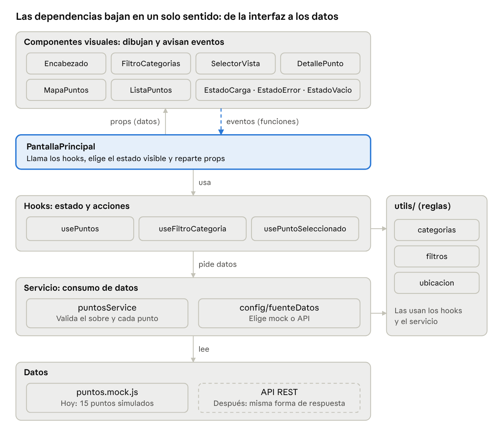

Cada capa solo conoce a la de abajo. Las utilidades de `utils/` no dependen de nadie, así que las pueden usar los hooks y el servicio.

**Estructura de carpetas propuesta** (React Native con Expo)

```text
BiciPuntos/
├── App.js                         Punto de entrada: muestra PantallaPrincipal
└── src/
    ├── data/
    │   └── puntos.mock.js         Materia prima (solo la lee el servicio)
    ├── config/
    │   └── fuenteDatos.js         Define si se usa el mock o la API real
    ├── services/
    │   └── puntosService.js       Obtiene la respuesta y valida sobre y puntos
    ├── utils/
    │   ├── categorias.js          Catálogo de categorías y normalización
    │   ├── filtros.js             Filtrar por categoría y buscar por id
    │   └── ubicacion.js           Validar coordenadas
    ├── hooks/
    │   ├── usePuntos.js
    │   ├── useFiltroCategoria.js
    │   └── usePuntoSeleccionado.js
    ├── screens/
    │   └── PantallaPrincipal.js   Llama los hooks y reparte props
    ├── components/
    │   ├── Encabezado.js
    │   ├── FiltroCategorias.js
    │   ├── ChipCategoria.js
    │   ├── SelectorVista.js
    │   ├── MapaPuntos.js
    │   ├── MarcadorPunto.js
    │   ├── ListaPuntos.js
    │   ├── TarjetaPunto.js
    │   ├── DetallePunto.js
    │   └── estados/
    │       ├── EstadoCarga.js
    │       ├── EstadoError.js
    │       └── EstadoVacio.js
    └── theme/
        └── colores.js             Colores de cada categoría y de la app
```

**Responsabilidad de cada carpeta**

| Carpeta | Responsabilidad | Puede usar | No debe |
| --- | --- | --- | --- |
| `data/` | Guardar la materia prima | — | Ser importada por componentes |
| `config/` | Elegir la fuente de datos (mock o API) en un solo lugar | — | Contener lógica |
| `services/` | Obtener la respuesta, validarla y devolver los puntos o un error | `data/`, `config/`, `utils/` | Usar React o guardar estado |
| `utils/` | Reglas puras: categorías, filtros y coordenadas | — | Usar React o dibujar |
| `hooks/` | Guardar el estado de la pantalla y ofrecer acciones | `services/`, `utils/` | Dibujar |
| `screens/` | Orquestar: llamar los hooks, elegir el estado y pasar props | `hooks/`, `components/`, `utils/` | Consultar datos directamente |
| `components/` | Dibujar y avisar eventos del usuario mediante props | `theme/` | Llamar servicios o hooks de datos |
| `theme/` | Colores y medidas compartidas | — | — |

## 3.1 Capa de consumo de datos

Un solo módulo, `puntosService`, obtiene los datos, interpreta el sobre y entrega a la app un resultado limpio. Es la única pieza que sabe si los datos vienen del mock o de una API.

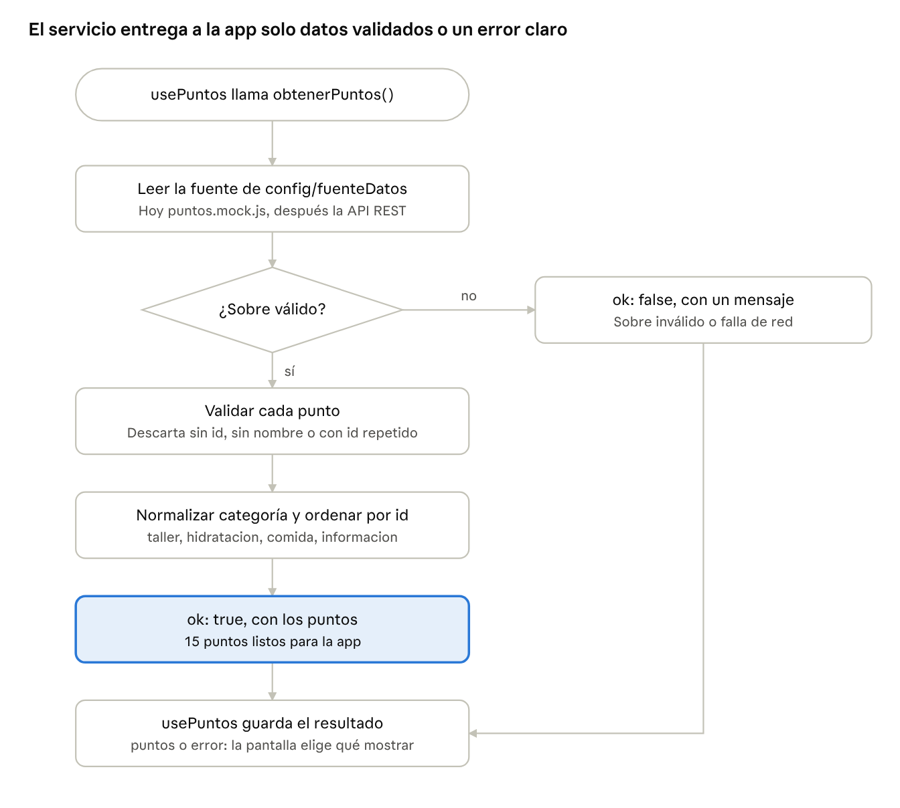

Los dos caminos, éxito y error, terminan en `usePuntos`: la interfaz nunca recibe el sobre crudo.

**Contrato del servicio**

| Función | Entrada | Resultado si todo sale bien | Resultado si falla |
| --- | --- | --- | --- |
| `obtenerPuntos()` | Ninguna (la fuente sale de `config/fuenteDatos.js`) | `{ ok: true, puntos: [...] }` con los puntos ya validados y ordenados | `{ ok: false, mensaje: "No se pudieron cargar los puntos" }` |

El servicio siempre responde de forma asíncrona, aunque el mock sea inmediato. Así, pasar a la API real no cambia la forma de usarlo. En el modo mock se puede simular una demora corta para probar la pantalla de carga.

**Respuestas a las preguntas de la capa de consumo**

| # | Pregunta | Respuesta |
| --- | --- | --- |
| 1 | ¿Qué módulo consume la información? | `src/services/puntosService.js`, apoyado en `config/fuenteDatos.js` para saber de dónde leer. |
| 2 | Responsabilidad del servicio | Obtener la respuesta, validar el sobre y cada punto, normalizar categorías y devolver `{ ok, puntos }` o `{ ok, mensaje }`. No guarda estado ni conoce pantallas. |
| 3 | ¿El componente debe leer `puntos.mock.js`? | No. Quedaría atado al archivo, repetiría validaciones y al pasar a la API habría que modificar cada componente. |
| 4 | API REST vs. archivo mock | La API es una petición HTTP que tarda y puede fallar (red, servidor, códigos 4xx y 5xx). El mock es un dato local inmediato que nunca falla. El servicio trata ambos igual: asíncrono y con manejo de errores. |
| 5 | ¿Qué debe retornar el servicio? | La colección validada o un error con mensaje; nunca el sobre crudo. |
| 6 | ¿Quién interpreta la respuesta general? | El servicio: lee `status`, `mensaje`, `error` y `data`. Los hooks reciben un resultado ya interpretado. |
| 7 | ¿Cómo se manejan los errores? | Falla de red o tiempo agotado: "Sin conexión". `status: false` o `error` con datos: el `mensaje` del servicio. `data` con formato inesperado: "Datos no válidos". `usePuntos` lo convierte en el estado de error y la pantalla muestra Reintentar. |
| 8 | Si se cambia el mock por una API real, ¿qué se modifica? | Solo `config/fuenteDatos.js` (URL y modo) y el interior de `puntosService`. Hooks, pantalla y componentes no cambian mientras el servicio entregue el mismo resultado. |
| 9 | Ventajas de separar el consumo de la interfaz | Un solo lugar para cambiar la fuente, validación en un solo punto, componentes más simples y fáciles de probar, y la opción de agregar caché o reintentos sin tocar la interfaz. |

## 3.2 Capa de lógica y estado (hooks)

La app necesita 3 hooks: uno por cada cosa que cambia en la pantalla (los datos, el filtro y la selección). Los tres se usan solo en `PantallaPrincipal`, que reparte el resultado por props; así hay una sola fuente de verdad.

**Inventario de hooks**

| Hook propuesto | Responsabilidad | Estado que administra | Qué entrega | Quién lo utiliza |
| --- | --- | --- | --- | --- |
| `usePuntos` | Pedir los puntos al servicio al iniciar y manejar la carga y el error | `puntos` (colección original), `cargando`, `error` | `puntos`, `cargando`, `error`, `recargar()` | `PantallaPrincipal` |
| `useFiltroCategoria` | Guardar la categoría elegida y calcular la colección filtrada desde la original | `categoriaSeleccionada` (clave o `null` = todas) | `categoriaSeleccionada`, `puntosFiltrados` (calculado), `seleccionarCategoria(clave)`, `limpiarFiltro()` | `PantallaPrincipal` |
| `usePuntoSeleccionado` | Guardar el id del punto elegido y recuperar el objeto completo | `idSeleccionado` (número o `null`) | `puntoSeleccionado` (calculado), `seleccionarPunto(id)`, `cerrarDetalle()` | `PantallaPrincipal` |

No hay un hook aparte para carga y error: hay una sola consulta y `usePuntos` ya la controla. Si más adelante hubiera varias consultas, se extraería un hook genérico de consultas. El modo de vista (mapa o lista) es un estado simple de `PantallaPrincipal` y no justifica un hook.

**Estados de la aplicación**

| Estado | Tipo | Valor inicial | Dónde vive | ¿Se guarda o se calcula? |
| --- | --- | --- | --- | --- |
| `puntos` | arreglo de puntos | `[]` | `usePuntos` | Se guarda |
| `cargando` | booleano | `true` | `usePuntos` | Se guarda |
| `error` | texto o `null` | `null` | `usePuntos` | Se guarda |
| `categoriaSeleccionada` | texto o `null` | `null` (todas) | `useFiltroCategoria` | Se guarda |
| `idSeleccionado` | número o `null` | `null` | `usePuntoSeleccionado` | Se guarda |
| `vista` | `'mapa'` o `'lista'` | `'mapa'` | `PantallaPrincipal` | Se guarda |
| `puntosFiltrados` | arreglo de puntos | los 15 | `useFiltroCategoria` | Se calcula desde `puntos` y la categoría |
| `puntoSeleccionado` | punto o `null` | `null` | `usePuntoSeleccionado` | Se calcula buscando `idSeleccionado` en `puntos` |
| `cantidadVisible` | número | 15 | `PantallaPrincipal` | Se calcula: tamaño de `puntosFiltrados` |

Lo calculado no se guarda como estado aparte: así nunca puede quedar desactualizado respecto a los datos de los que sale.

**Respuestas a las preguntas de la capa de hooks**

| # | Pregunta | Respuesta |
| --- | --- | --- |
| 1 | Responsabilidades de la capa | Conectar el servicio con la interfaz, guardar el estado de la pantalla, aplicar las reglas (filtrar, buscar por id) usando las utilidades, y entregar datos listos y acciones. |
| 2 | ¿Hook para consultar? | Sí: `usePuntos`. |
| 3 | ¿Hook para filtrar? | Sí: `useFiltroCategoria`. Saca la lógica del componente y el mapa y la lista usan el mismo resultado. |
| 4 | ¿Hook para seleccionar? | Sí: `usePuntoSeleccionado`. Guarda el id y devuelve el objeto completo. |
| 5 | ¿Hook para carga y error? | No por separado: lo hace `usePuntos`, porque hay una sola consulta. |
| 6 | Servicio vs. hook | El servicio es una función sin estado ni React: sabe de dónde salen los datos y los valida. El hook usa React: guarda los datos mientras la pantalla existe y hace que la interfaz se actualice cuando cambian. |
| 7 | Qué administra cada hook | Ver el inventario. |
| 8 | Qué componentes acceden | Solo `PantallaPrincipal` llama los hooks; los hijos reciben lo necesario por props. |
| 9 | Cómo no repetir lógica | Las reglas viven en `utils/` (filtrar, buscar por id, validar coordenadas) y las usan los hooks; los componentes visuales no tienen reglas. |
| 10 | Estados que se necesitan | Ver la tabla de estados: 6 guardados y 3 calculados. |
| 11 | Cómo se actualiza la interfaz | Cuando un hook cambia su estado, React vuelve a dibujar `PantallaPrincipal` y los hijos reciben props nuevas. |
| 12 | Lógica fuera de los componentes visuales | Consultar y validar (servicio); normalizar categorías, filtrar, buscar por id y validar coordenadas (utils); decidir el estado de la pantalla (hooks). |

## 3.3 Capa de componentes visuales

Se proponen 14 componentes. `PantallaPrincipal` orquesta y los demás solo dibujan y avisan eventos; 3 de ellos se repiten una vez por cada punto o categoría.

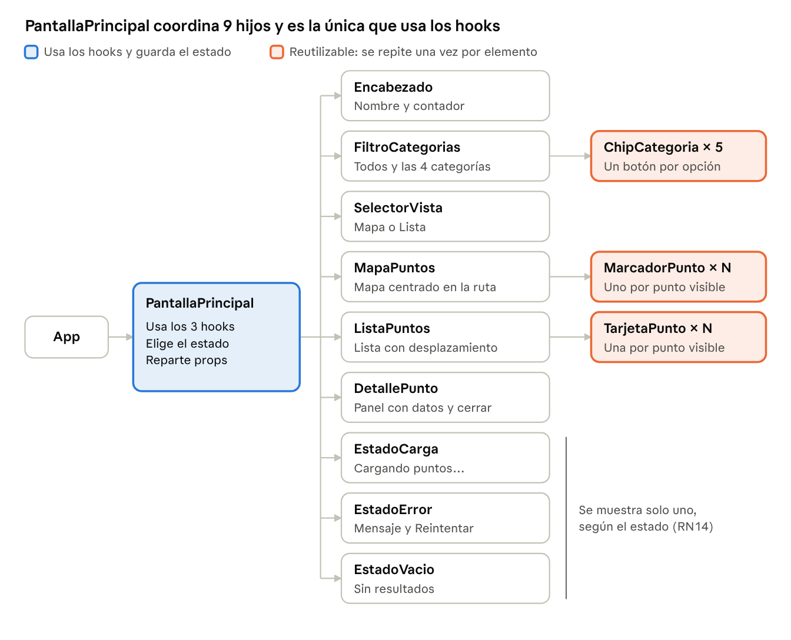

Entre `MapaPuntos` y `ListaPuntos` solo se ve uno, según la vista; lo mismo pasa con los tres componentes de estado.

**Inventario de componentes**

| Componente | Tipo | Responsabilidad | Padre | Hijos | Props que recibe | Estado local |
| --- | --- | --- | --- | --- | --- | --- |
| `App` | Raíz | Montar la pantalla principal | — | `PantallaPrincipal` | — | — |
| `PantallaPrincipal` | Pantalla contenedora | Llamar los hooks, elegir el estado visible, repartir props y aplicar RN13 | `App` | Todos los de abajo | — | `vista` |
| `Encabezado` | Presentación | Nombre de la app y contador de puntos | `PantallaPrincipal` | — | `cantidadVisible` | — |
| `FiltroCategorias` | Contenedor de controles | Mostrar "Todos" y las 4 categorías | `PantallaPrincipal` | `ChipCategoria` × 5 | `categorias`, `categoriaSeleccionada`, `onCambiarCategoria`, `deshabilitado` | — |
| `ChipCategoria` | Presentación reutilizable | Un botón de categoría: icono, etiqueta y si está activo | `FiltroCategorias` | — | `etiqueta`, `icono`, `color`, `activo`, `onPress` | — |
| `SelectorVista` | Presentación | Alternar entre Mapa y Lista | `PantallaPrincipal` | — | `vista`, `onCambiarVista` | — |
| `MapaPuntos` | Contenedor del mapa | Dibujar el mapa centrado en la ruta | `PantallaPrincipal` | `MarcadorPunto` × N | `puntos` (solo con ubicación válida), `idSeleccionado`, `onSeleccionar` | Zona visible del mapa |
| `MarcadorPunto` | Presentación reutilizable | Un marcador con el icono y color de su categoría | `MapaPuntos` | — | `punto`, `seleccionado`, `onPress` | — |
| `ListaPuntos` | Contenedor de lista | Lista con desplazamiento | `PantallaPrincipal` | `TarjetaPunto` × N | `puntos`, `idSeleccionado`, `onSeleccionar` | — |
| `TarjetaPunto` | Presentación reutilizable | Un punto en forma de tarjeta | `ListaPuntos` | — | `punto`, `seleccionado`, `onPress` | — |
| `DetallePunto` | Presentación (panel inferior) | Información completa del punto y botón cerrar | `PantallaPrincipal` | — | `punto`, `onCerrar` | — |
| `EstadoCarga` | Presentación | Indicador "Cargando puntos…" | `PantallaPrincipal` | — | — | — |
| `EstadoError` | Presentación | Mensaje de error y botón Reintentar | `PantallaPrincipal` | — | `mensaje`, `onReintentar` | — |
| `EstadoVacio` | Presentación | "No hay puntos de esta categoría" y Mostrar todos | `PantallaPrincipal` | — | `onMostrarTodos` | — |

**Por qué 14 componentes**

- Cada uno tiene un solo motivo para cambiar: si cambia el diseño del filtro, solo se tocan `FiltroCategorias` y `ChipCategoria`.
- `ChipCategoria`, `MarcadorPunto` y `TarjetaPunto` existen porque se repiten: 5 chips y hasta 15 marcadores o tarjetas con el mismo diseño.
- Los tres estados son componentes separados para que la pantalla solo elija cuál mostrar.
- `MapaPuntos` aísla la librería de mapas: si se cambia de librería, solo cambian `MapaPuntos` y `MarcadorPunto`.
- No se divide más (por ejemplo, cada fila del detalle) porque esas piezas se usarían una sola vez y no tienen lógica propia.

**Respuestas a las preguntas de la capa de componentes**

| # | Pregunta | Respuesta |
| --- | --- | --- |
| 1 | Componentes de la pantalla principal | `Encabezado`, `FiltroCategorias`, `SelectorVista`, `MapaPuntos` o `ListaPuntos`, `DetallePunto` y los tres de estado. |
| 2 | ¿Componente independiente para filtros? | Sí, `FiltroCategorias`, con un `ChipCategoria` por opción. |
| 3 | ¿Componente para cada punto? | Sí: `MarcadorPunto` en el mapa y `TarjetaPunto` en la lista. |
| 4 | ¿Componente para el detalle? | Sí, `DetallePunto`. |
| 5 | ¿El mapa es independiente? | Sí, para aislar la librería de mapas del resto de la app. |
| 6 | Responsabilidades | Ver el inventario. |
| 7 | Reutilizables | `ChipCategoria`, `MarcadorPunto` y `TarjetaPunto`; los tres de estado sirven también para futuras pantallas. |
| 8 | Reciben props | Todos, menos `App` y `PantallaPrincipal`. |
| 9 | Con estado local | `PantallaPrincipal` (la vista) y `MapaPuntos` (la zona visible del mapa). Los datos no son estado local de nadie: vienen de los hooks. |
| 10 | Hijos de la pantalla | `Encabezado`, `FiltroCategorias`, `SelectorVista`, `MapaPuntos`, `ListaPuntos`, `DetallePunto`, `EstadoCarga`, `EstadoError` y `EstadoVacio`. |
| 11 | Componentes divisibles | `FiltroCategorias` en chips, `MapaPuntos` en marcadores y `ListaPuntos` en tarjetas. `DetallePunto` podría dividirse si crece. |
| 12 | Cómo evitar un componente que lo haga todo | La lógica va en hooks y utils, la pantalla solo coordina y los componentes visuales no tienen reglas de negocio. |

## 4. Comunicación entre componentes

Los datos bajan por props desde `PantallaPrincipal` y los eventos suben con funciones que ella entrega a sus hijos. La selección viaja solo como `id`: el objeto completo siempre se busca en la colección original.

### Escenario A. Visualización de los 15 puntos

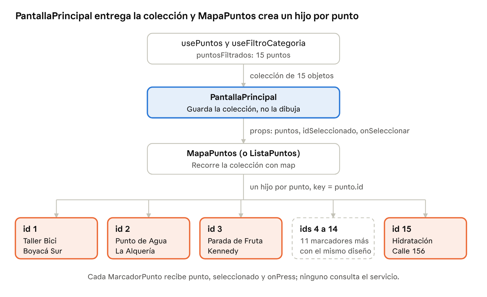

La colección baja una sola vez por props; `MapaPuntos` crea un `MarcadorPunto` por elemento y usa el `id` como llave.

| # | Pregunta | Respuesta |
| --- | --- | --- |
| 1 | ¿Quién obtiene la colección? | `PantallaPrincipal`, a través de `usePuntos` y `useFiltroCategoria`. |
| 2 | ¿Quién presenta los puntos? | `MapaPuntos` (o `ListaPuntos`); cada `MarcadorPunto` o `TarjetaPunto` dibuja uno. |
| 3 | ¿Cómo baja la colección? | Por props: la pantalla pasa `puntos` a `MapaPuntos`, que recorre la colección y pasa un `punto` a cada `MarcadorPunto`. |
| 4 | ¿Qué recibe el componente de un punto? | El objeto `punto`, si está `seleccionado` y la función `onPress`. |
| 5 | ¿El hijo consulta otra vez el servicio? | No. Solo el hook consulta; si los hijos lo hicieran habría peticiones repetidas y datos distintos en cada uno. |
| 6 | ¿Qué mecanismo usa el padre? | Props, en un solo sentido: de padre a hijo. |
| 7 | ¿Qué pasa si cambia la colección? | React vuelve a dibujar `MapaPuntos` con la colección nueva: aparecen o desaparecen marcadores, y los que siguen se reutilizan. |
| 8 | ¿Cómo se identifica cada elemento? | Con `key` = `punto.id`, que es único. |

### Escenario B. Selección del punto 7: Café Rodante Boyacá

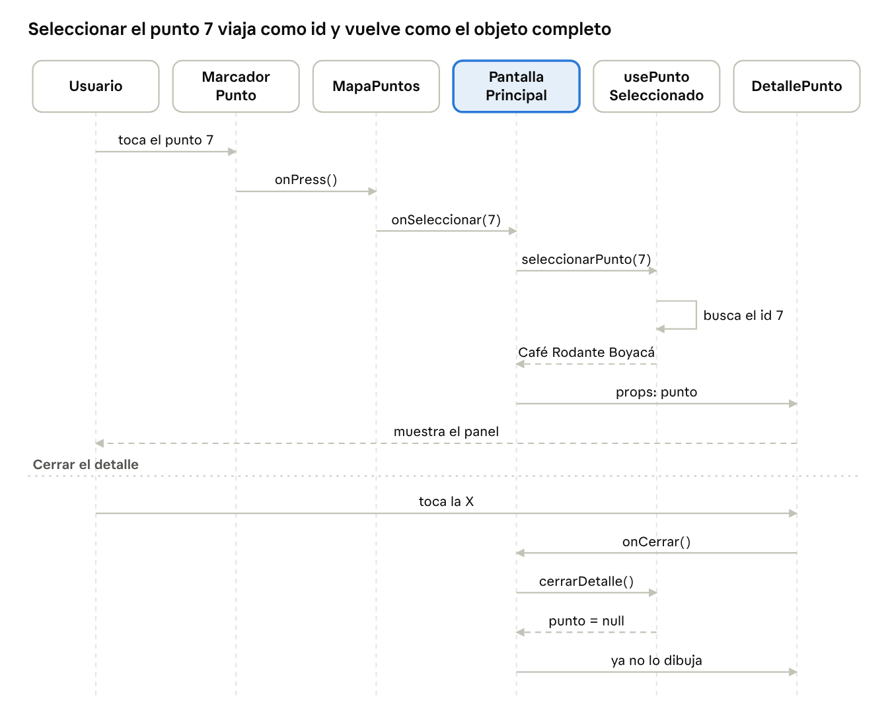

Flecha continua: llamada. Flecha punteada: respuesta. El id 7 sube hasta la pantalla y el objeto completo baja al detalle.

| # | Pregunta | Respuesta |
| --- | --- | --- |
| 1 | ¿Quién detecta la selección? | El `MarcadorPunto` (o la `TarjetaPunto`) que el usuario tocó. |
| 2 | ¿Cómo avisa el hijo al padre? | Llama `onPress()`, que `MapaPuntos` conecta con `onSeleccionar(7)`, la función que le dio `PantallaPrincipal`. |
| 3 | Mecanismo hijo → padre | Una función (callback) que el padre entrega por props. |
| 4 | ¿Objeto completo o id? | Solo el id: es pequeño, único y estable. El objeto se busca en la colección original, así nunca hay una copia desactualizada. |
| 5 | ¿Quién conserva el seleccionado? | `PantallaPrincipal`, con `usePuntoSeleccionado` (`idSeleccionado` = 7). |
| 6 | ¿Cómo se recupera el objeto? | Buscando en `puntos` el elemento cuyo `id` es 7: Café Rodante Boyacá. |
| 7 | ¿Quién recibe el punto para el detalle? | `DetallePunto`, en la prop `punto`. |
| 8 | ¿Cómo se cierra el detalle? | Con la X del panel, tocando fuera de él o con el botón atrás de Android. |
| 9 | ¿Cómo se comunica el cierre? | `DetallePunto` llama `onCerrar()`; la pantalla ejecuta `cerrarDetalle()`, `idSeleccionado` pasa a `null` y el panel deja de mostrarse. |
| 10 | ¿Y si elige otro punto con el detalle abierto? | `onSeleccionar(nuevoId)` reemplaza el id; el mismo panel muestra el punto nuevo. Nunca hay dos paneles. |

### Escenario C. Filtro por la categoría `hidratacion`

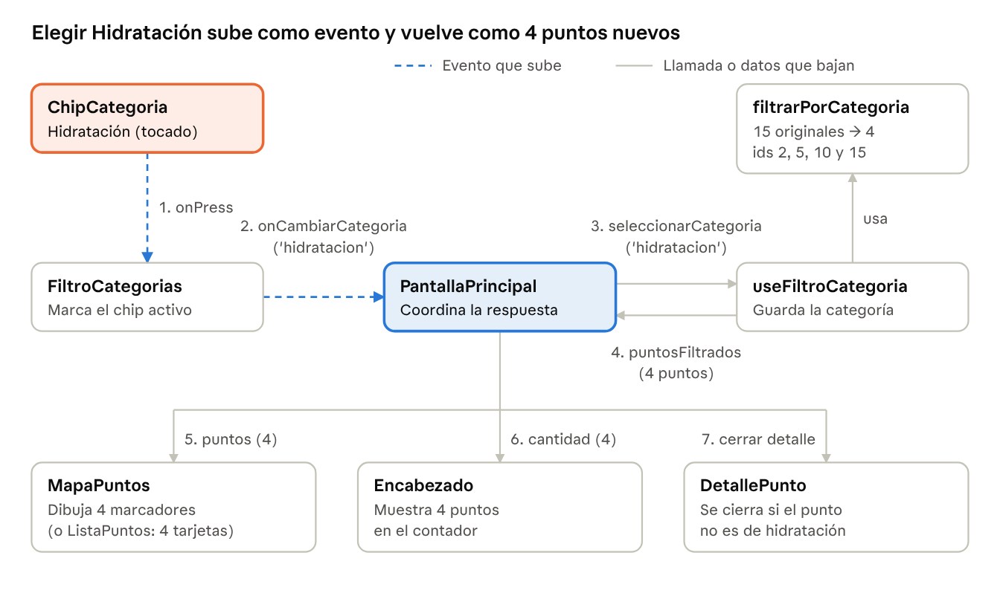

Los números marcan el orden. El filtro se calcula en el hook, nunca en un componente, y la colección original sigue con 15 puntos.

| # | Pregunta | Respuesta |
| --- | --- | --- |
| 1 | ¿Quién presenta las opciones? | `FiltroCategorias`, con un `ChipCategoria` por opción. |
| 2 | ¿Quién detecta el cambio? | El `ChipCategoria` "Hidratación" que el usuario tocó. |
| 3 | ¿Cómo llega al padre? | El chip llama `onPress`; `FiltroCategorias` llama `onCambiarCategoria('hidratacion')`, que es de `PantallaPrincipal`. |
| 4 | ¿Dónde se filtra? | En `useFiltroCategoria`, con la función `filtrarPorCategoria` de `utils/`. Nunca en un componente visual. |
| 5 | ¿Qué necesita el filtro? | La colección original y la clave de la categoría. |
| 6 | ¿Cómo se obtiene la colección nueva? | Creando una lista nueva con los puntos de esa categoría: 4 puntos (ids 2, 5, 10 y 15). La original sigue con 15. |
| 7 | ¿Quién recibe los resultados? | `MapaPuntos` o `ListaPuntos` en la prop `puntos`, y `Encabezado` el contador (4). |
| 8 | ¿Cómo se actualiza la interfaz? | Cambia el estado `categoriaSeleccionada`, React vuelve a dibujar la pantalla y los hijos reciben props nuevas. |
| 9 | ¿Y "Mostrar todos"? | `onCambiarCategoria(null)`: se muestra la colección original de 15. |
| 10 | ¿Y si no hay coincidencias? | La colección filtrada queda vacía y la pantalla muestra `EstadoVacio` con "Mostrar todos". |
| 11 | ¿Y si había un punto seleccionado? | RN13: si el punto no es de la nueva categoría, el detalle se cierra. Ejemplo: con el punto 7 (comida) abierto, elegir Hidratación cierra el panel. |

## 5. Lógica de negocio

Las reglas viven en el servicio, en `utils/` y en los hooks; los componentes visuales solo muestran. La regla central: filtrar nunca modifica la colección original.

**Procesos**

| Proceso | Entrada | Reglas | Procesamiento | Resultado |
| --- | --- | --- | --- | --- |
| Cargar puntos | Respuesta del servicio (mock o API) | RN01 a RN05 | Validar el sobre, validar cada punto, normalizar la categoría, descartar inválidos y ordenar por id | Colección original o estado de error |
| Mostrar puntos | Colección visible y vista activa | RN06 y RN07 | En el mapa solo los puntos con coordenadas válidas; en la lista todos | Marcadores o tarjetas |
| Filtrar puntos | Colección original y clave de categoría | RN08 a RN10 | Si la clave es `null`, devolver la original; si no, comparar categorías normalizadas | Colección filtrada nueva; la original queda igual |
| Seleccionar punto | id del punto | RN11 y RN12 | Guardar el id; si había otro abierto, se reemplaza | Punto seleccionado |
| Consultar detalle | id seleccionado y colección original | RN11 | Buscar el punto cuyo `id` coincide | Objeto completo, o ninguno |
| Limpiar filtros | Toque en "Todos" o "Mostrar todos" | RN09 | Categoría seleccionada = `null` | Colección original visible |
| Gestionar estados | `cargando`, `error` y colección visible | RN14 | Elegir un solo estado por prioridad | Carga, error, sin resultados o con datos |

**Reglas de negocio**

| Código | Regla | Dónde se aplica |
| --- | --- | --- |
| RN01 | La respuesta es válida solo si `status` es `true`, `error` es `null` y `data` es un arreglo. Si no, estado de error con el `mensaje` | `puntosService` |
| RN02 | Un punto sin `id` o sin `nombre` se descarta: no se puede identificar ni mostrar | `puntosService` |
| RN03 | Los `id` deben ser únicos; si uno se repite, se conserva el primero | `puntosService` |
| RN04 | La categoría se compara normalizada (minúsculas, sin tildes ni espacios). Si no está en el catálogo, se agrupa como "Otros" con el icono 📍 | `utils/categorias` |
| RN05 | Si falta el icono se usa el de su categoría; si falta la descripción se muestra "Sin descripción disponible" | `utils/categorias` y `DetallePunto` |
| RN06 | Coordenadas válidas: `lat` y `lng` numéricos, `lat` entre -90 y 90, `lng` entre -180 y 180, y no ambas en 0 | `utils/ubicacion` |
| RN07 | Un punto sin coordenadas válidas no se dibuja en el mapa, pero sí aparece en la lista con "Ubicación no disponible" | `PantallaPrincipal`, con `tieneUbicacionValida()` |
| RN08 | Filtrar nunca modifica la colección original: siempre crea una colección nueva a partir de ella | `useFiltroCategoria` |
| RN09 | Categoría `null` significa "Todos": se muestra la colección original | `useFiltroCategoria` |
| RN10 | Si la categoría elegida no existe en el catálogo, se ignora y se muestran todos | `useFiltroCategoria` |
| RN11 | La selección viaja como `id` y el objeto se busca en la colección original. Si no existe, no se abre el detalle | `usePuntoSeleccionado` |
| RN12 | Seleccionar otro punto con el detalle abierto reemplaza el contenido; nunca hay dos detalles | `usePuntoSeleccionado` |
| RN13 | Al cambiar de categoría, si el punto seleccionado no pertenece a la nueva, se cierra el detalle | `PantallaPrincipal` |
| RN14 | Se muestra un solo estado a la vez, con prioridad: cargando, error, sin resultados, con datos | `PantallaPrincipal` |

**Pseudocódigo de los procesos principales** (descripción, no código ejecutable)

```text
PROCESO CargarPuntos
  mostrar estado "cargando"
  respuesta ← servicio.obtenerPuntos()
  SI respuesta.status ≠ verdadero O respuesta.error ≠ nulo O respuesta.data no es una lista
     error ← respuesta.mensaje, o "No se pudieron cargar los puntos"
     mostrar estado "error" y TERMINAR
  válidos ← lista vacía
  PARA CADA punto EN respuesta.data
     SI falta id O falta nombre O el id ya está en válidos: pasar al siguiente
     punto.categoria ← normalizar(punto.categoria)
     agregar punto a válidos
  puntos ← válidos ordenados por id
  mostrar estado "con datos" (o "sin resultados" si puntos está vacía)

PROCESO FiltrarPuntos(categoría)
  SI categoría es nula O no existe en el catálogo
     RETORNAR puntos                      (la colección original)
  RETORNAR nueva lista con los puntos cuya categoría = categoría

PROCESO SeleccionarPunto(id)
  punto ← buscar en puntos el que tenga ese id
  SI no existe: no abrir el detalle y TERMINAR
  idSeleccionado ← id                    (si había otro, se reemplaza)

PROCESO CambiarCategoría(nueva)
  categoríaSeleccionada ← nueva
  SI hay un punto seleccionado Y nueva no es nula Y la categoría del punto ≠ nueva
     cerrar el detalle                    (idSeleccionado ← nulo)
```

**Flujo de consulta**

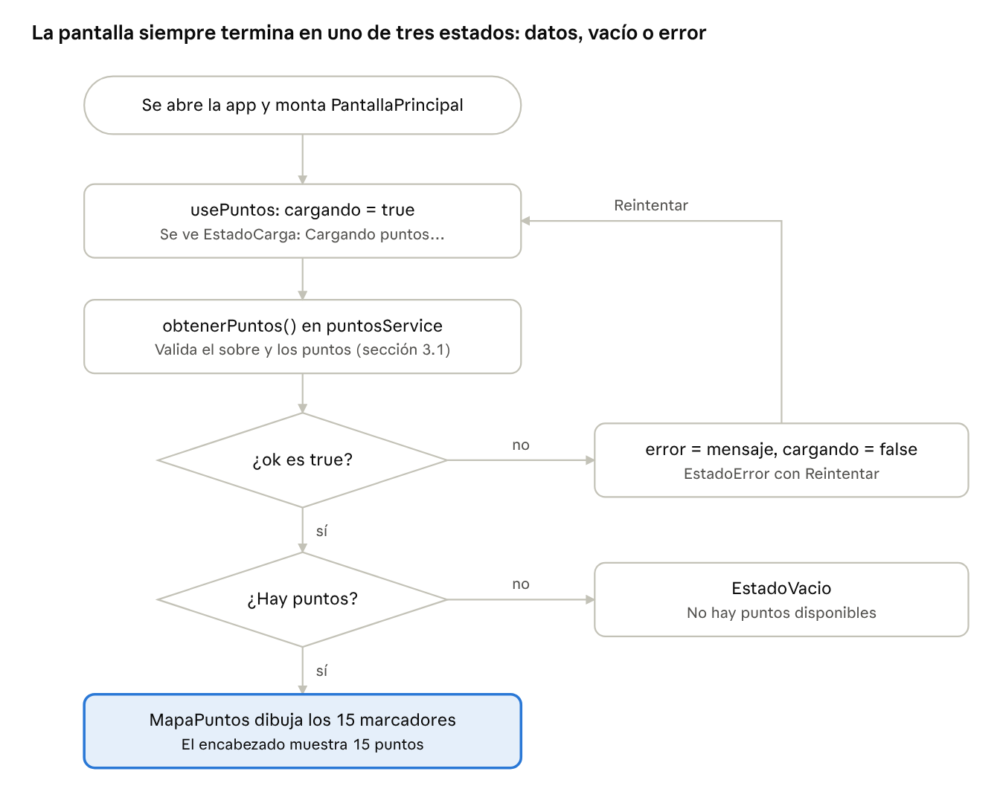

Reintentar vuelve al paso de carga sin recargar toda la app.

**Flujo de filtrado**

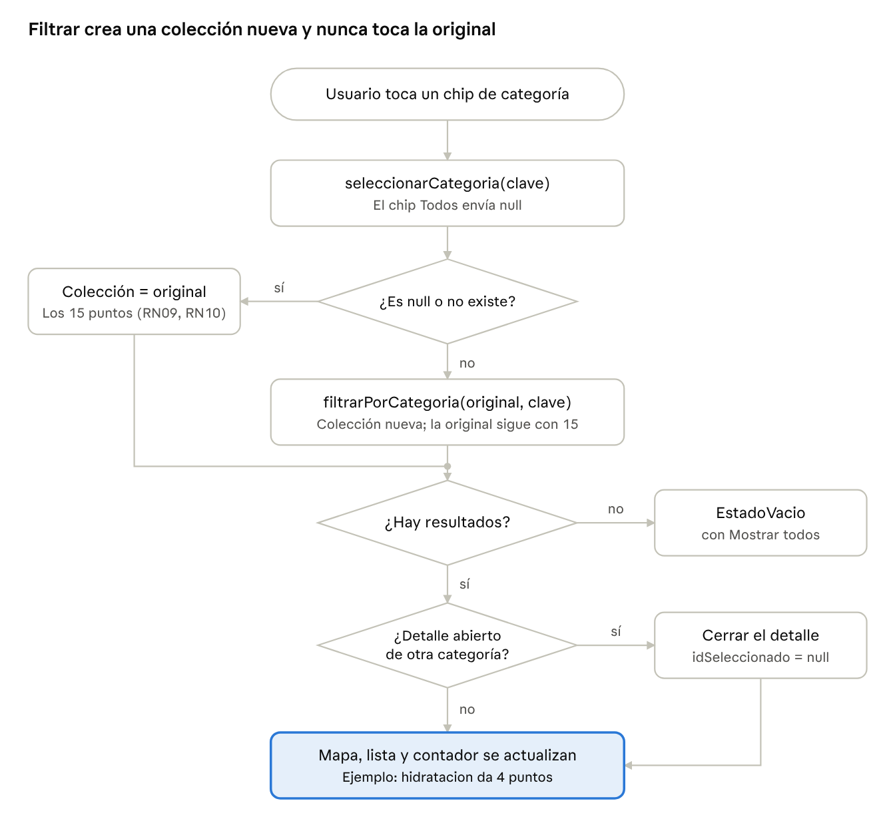

Los dos caminos, "Todos" y una categoría concreta, pasan por la misma revisión de resultados.

**Preguntas de profundización**

| # | Pregunta | Respuesta |
| --- | --- | --- |
| 1 | Colección original vs. filtrada | La original es todo lo que llegó del servicio (15 puntos) y se guarda. La filtrada es un subconjunto que se calcula para mostrar. |
| 2 | ¿Por qué no perder la original? | Si el filtro la reemplazara, para quitar el filtro habría que consultar otra vez, y filtrar dos veces seguidas daría vacío: `comida` sobre el resultado de `hidratacion` = 0 puntos. |
| 3 | Condiciones para estar en el mapa | Tener coordenadas válidas (RN06) y pasar el filtro activo. |
| 4 | Cómo validar las coordenadas | Que sean números, que estén en rango y que no sean (0, 0). Si un punto queda lejos de Bogotá se registra un aviso técnico, porque suele ser un error de signo, pero no se descarta. |
| 5 | Cómo saber si dos puntos son de la misma categoría | Comparando su categoría normalizada (RN04). |
| 6 | Si la categoría elegida no existe | Se ignora y se muestran todos (RN10). Si viene así en los datos, el punto va a "Otros" (RN04). |
| 7 | Si el punto seleccionado no está en la colección | No se abre el detalle (RN11). Si estaba abierto y desaparece tras recargar, se cierra. |
| 8 | Qué se conserva al cambiar de filtro | La colección original, la vista (mapa o lista) y la selección si el punto es de la nueva categoría. |
| 9 | Reglas que se centralizan | Validar la respuesta, normalizar categorías, el catálogo, filtrar, buscar por id y validar coordenadas. |
| 10 | Negocio vs. presentación | Negocio: qué puntos son válidos, cuáles se ven y cuál está seleccionado. Presentación: colores, tamaño de los marcadores, dónde aparece el panel y cómo se redactan los mensajes. |

## 6. Mockups y experiencia de usuario

La app tiene una sola pantalla. Las cuatro "pantallas" de la guía (mapa, filtros, detalle y sin resultados) son estados de esa misma pantalla, así el ciclista nunca pierde el mapa de vista ni tiene que navegar hacia atrás.

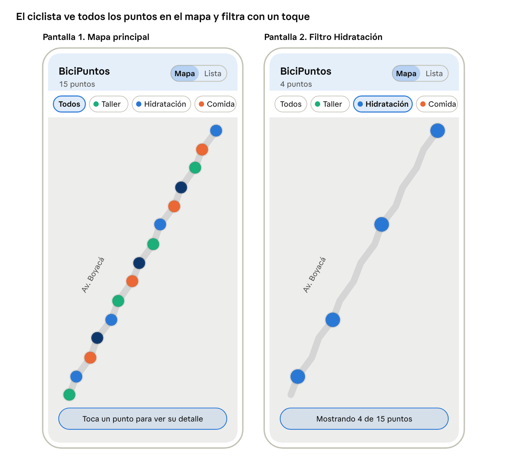

Los marcadores están ubicados con las coordenadas reales del archivo: por eso forman la línea de la Avenida Boyacá. El color identifica la categoría y el chip activo muestra el filtro.

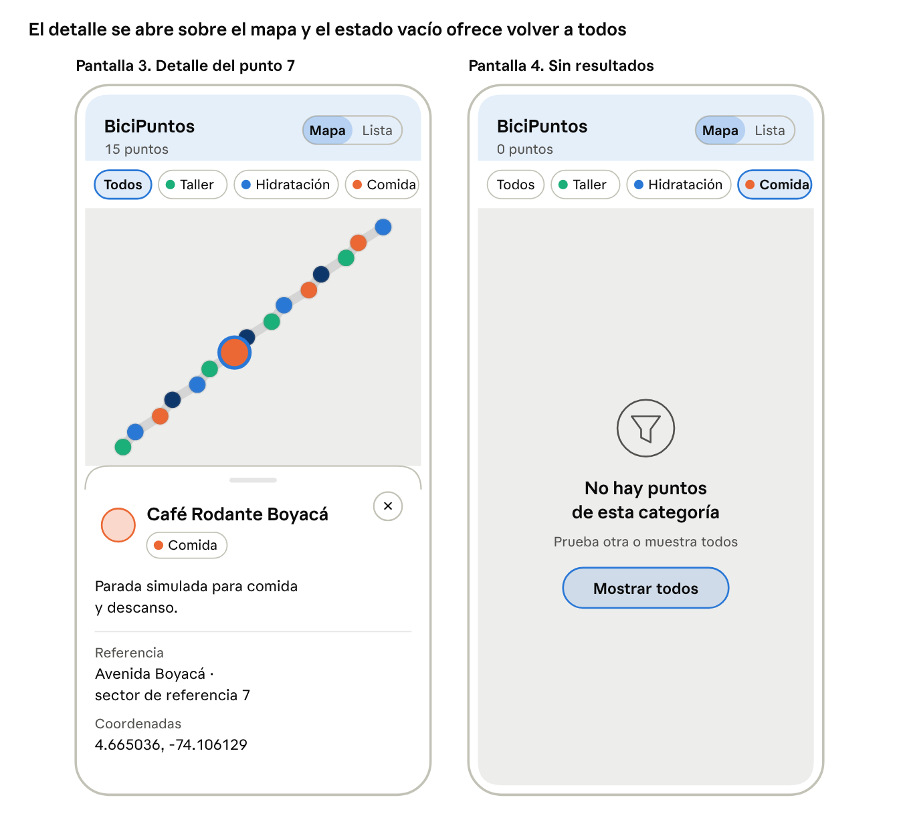

Con el archivo actual ninguna categoría queda vacía; la pantalla 4 cubre datos futuros de la API (aquí se ilustra con Comida).

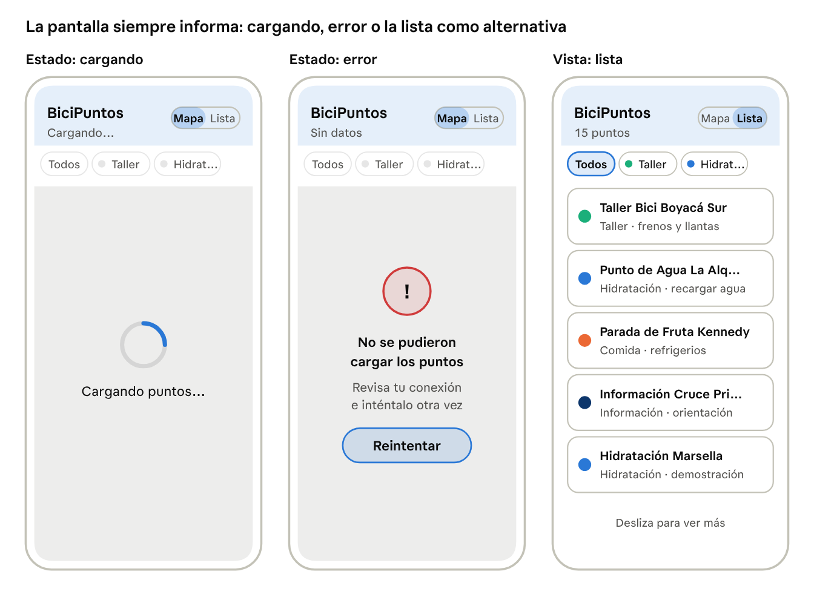

Durante la carga y el error los filtros se ven deshabilitados. La lista muestra los mismos puntos que el mapa, ordenados por id.

**Respuestas a las preguntas de diseño**

| # | Pregunta | Respuesta |
| --- | --- | --- |
| 1 | ¿Cuántas pantallas? | Una pantalla principal con vistas y estados: mapa o lista, panel de detalle, y estados de carga, error y sin resultados. |
| 2 | ¿Qué se ve al inicio? | El mapa con los 15 marcadores, los filtros con "Todos" activo y el contador "15 puntos". |
| 3 | ¿Dónde van los filtros? | En una fila de chips debajo del encabezado, siempre visible, con desplazamiento lateral si no caben. |
| 4 | ¿Cómo se diferencian las categorías? | Por icono, texto y un color propio. El color nunca va solo (RNF06). |
| 5 | ¿Cómo se ve el punto seleccionado? | Su marcador crece y lleva borde, su tarjeta se resalta y se abre el panel de detalle. |
| 6 | ¿Cómo se ve el detalle? | Como un panel inferior que cubre cerca del 40 % de la pantalla, encima del mapa. |
| 7 | ¿Cómo se cierra? | Con la X del panel, tocando fuera de él o con el botón atrás. |
| 8 | Mensaje cuando no hay puntos | "No hay puntos de esta categoría", con el botón "Mostrar todos". |
| 9 | ¿Cómo se ve la carga? | Un indicador circular con "Cargando puntos…" en el área del mapa, y los chips deshabilitados. |
| 10 | ¿Qué sigue visible al cambiar de categoría? | El encabezado, los chips, el selector Mapa / Lista y el contador. |
| 11 | ¿Cómo se adapta a otros tamaños? | Los chips se desplazan de lado, el mapa ocupa todo el espacio libre y el panel de detalle usa una altura relativa con desplazamiento si el texto es largo. |

## 7. Diagramas de procesos y navegación

Los 7 diagramas que pide la guía están en el documento; los dos que faltaban, estados y navegación, van en esta sección. Todos usan los mismos nombres de las tablas de inventario, para que un desarrollador nuevo pueda seguirlos sin otra explicación.

| Diagrama de la guía | Qué representa | Dónde está |
| --- | --- | --- |
| Arquitectura general | Relación entre servicios, hooks, componentes y datos | Sección 3 |
| Árbol de componentes | Jerarquía padre-hijo | Sección 3.3 |
| Flujo de consulta | Desde la solicitud de datos hasta su visualización | Sección 5 |
| Flujo de filtrado | Desde la categoría elegida hasta los resultados | Sección 5 |
| Diagrama de secuencia | Seleccionar un punto y mostrar su detalle | Sección 4, escenario B |
| Diagrama de estados | Carga, datos disponibles, error y sin resultados | Esta sección |
| Flujo de navegación | Transiciones entre vistas | Esta sección |

Además hay tres diagramas de apoyo: la capa de consumo (3.1) y la comunicación de los escenarios A y C (4).

**Diagrama de estados**

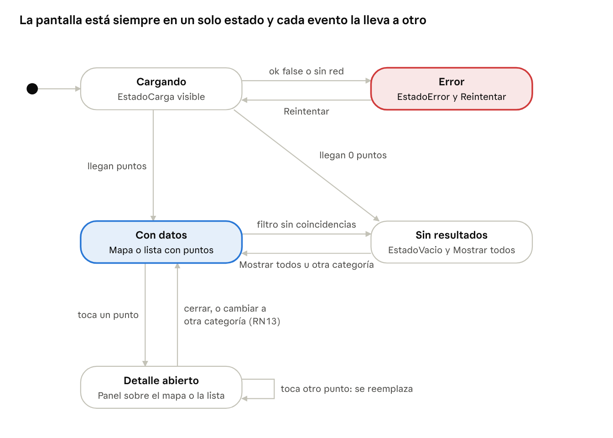

El detalle solo puede abrirse desde "Con datos"; el error solo se sale con Reintentar.

**Flujo de navegación**

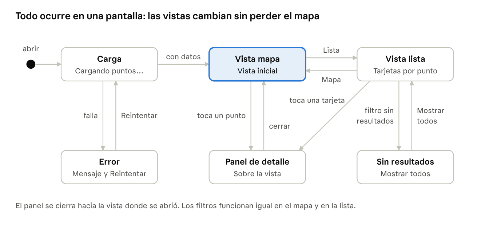

No hay pantallas apiladas: el botón atrás de Android solo cierra el panel de detalle si está abierto.

## 8. MVP y priorización MoSCoW

El MVP es: cargar los puntos, verlos en el mapa, filtrarlos por categoría y abrir el detalle de uno, con los estados de carga, error y sin resultados. Una app que muestra puntos pero no deja seleccionarlos no responde la pregunta del ciclista ("¿qué hay ahí?"), así que la selección y el detalle son obligatorios.

| Funcionalidad | Prioridad MoSCoW | Justificación | Dependencias |
| --- | --- | --- | --- |
| RF01 Cargar puntos y validar la respuesta | Must | Sin datos no hay app | Catálogo de categorías |
| RF09 Informar carga | Must | El usuario debe saber que la app está trabajando | RF01 |
| RF10 Informar error | Must | Evita una pantalla en blanco cuando falla la consulta | RF01 |
| RF02 Mapa con marcadores | Must | Los datos son geográficos; es la vista principal | RF01 y una librería de mapas |
| RF06 Seleccionar un punto | Must | Sin selección la app no es funcional | RF02 o RF03 |
| RF07 Ver detalle | Must | Es el objetivo: conocer el punto | RF06 |
| RF08 Cerrar detalle | Must | Sin cerrar, el usuario queda atrapado en el panel | RF07 |
| RF04 Filtrar por categoría | Must | Es la forma principal de buscar un tipo de servicio | RF01 |
| RF05 Mostrar todos | Must | Sin esto el filtro no tendría vuelta atrás | RF04 |
| RF11 Informar sin resultados | Must | Todo filtro debe contemplar el caso vacío, aunque el mock actual no lo produzca | RF04 |
| RF03 Lista de tarjetas | Should | Alternativa para web y accesibilidad; el mapa ya cubre el uso principal | RF01 |
| RF13 Cambiar entre mapa y lista | Should | Solo tiene sentido cuando existe la lista | RF03 |
| RF12 Contador de resultados | Should | Ayuda a entender el filtro, pero no bloquea | RF04 |
| Botón Reintentar (parte de RF10) | Should | Útil; sin él el usuario puede reabrir la app | RF10 |
| Búsqueda por nombre | Could | Con 15 puntos aporta poco; sirve cuando haya más datos | RF01 |
| Ubicación del usuario y distancia a cada punto | Could | Mejora mucho la experiencia, pero exige permisos de ubicación | RF02 |
| "Cómo llegar" abriendo Google Maps | Could | Aprovecha las coordenadas sin construir rutas propias | RF07 |
| Varias categorías a la vez | Could | Mejora el filtro, no es esencial | RF04 |
| Favoritos | Could | Necesita guardar datos en el celular | RF07 |
| Rutas punto a punto dentro de la app | Won't | El archivo no trae datos de rutas | — |
| Cuentas de usuario | Won't | No hay datos de usuarios | — |
| Crear, editar o borrar puntos | Won't | El servicio es solo de consulta | — |
| Modo sin conexión con mapas descargados | Won't | Complejidad alta para una primera versión | — |
| Comentarios y calificaciones | Won't | No existen en los datos | — |

**Respuestas a las preguntas del MVP**

1. **Funcionalidad mínima:** cargar los puntos, verlos en el mapa y abrir el detalle de uno.
2. **¿Es funcional si muestra pero no deja seleccionar?** No: el usuario ve marcadores pero no puede saber qué es cada uno.
3. **Obligatorias:** las marcadas como Must.
4. **Segunda iteración:** las Should.
5. **Mejoras, no necesidades:** las Could.
6. **Excluidas expresamente:** las Won't.
7. **Dependencias:** hay dos cadenas. Cargar → mostrar → seleccionar → detalle → cerrar. Cargar → filtrar → mostrar todos y sin resultados.
8. **Orden de implementación:** el de la sección 9.

## 9. Plan de implementación por etapas

Se construye de adentro hacia afuera: primero los datos, luego la lógica y al final la interfaz. La lista va antes que el mapa porque es más simple, no depende de una librería externa y permite probar los hooks.

| Etapa | Qué se construye | Depende de | Cómo se sabe que está terminada |
| --- | --- | --- | --- |
| E1. Base | Proyecto Expo, estructura de carpetas, catálogo de categorías y `puntos.mock.js` en `src/data/` | — | La app abre una pantalla vacía sin errores |
| E2. Capa de datos | `puntosService` (lee el mock, valida el sobre y cada punto) y las reglas en `utils/` | E1 | El servicio entrega 15 puntos; con datos alterados entrega un error controlado |
| E3. Hooks | `usePuntos`, `useFiltroCategoria` y `usePuntoSeleccionado` | E2 | Con una pantalla de prueba: cargando → 15 puntos; filtro `hidratacion` → 4 |
| E4. Pantalla y estados | `PantallaPrincipal`, `Encabezado`, `EstadoCarga`, `EstadoError` y `EstadoVacio` | E3 | Cada estado se ve al forzarlo (demora, error, filtro vacío) |
| E5. Lista | `ListaPuntos` y `TarjetaPunto` | E4 | 15 tarjetas; tocar una entrega su id a la pantalla |
| E6. Filtros | `FiltroCategorias` y `ChipCategoria` | E3 y E5 | `hidratacion` → 4 tarjetas; Todos → 15 |
| E7. Mapa | `MapaPuntos` y `MarcadorPunto` con `react-native-maps` | E3 y E4 | 15 marcadores en la Avenida Boyacá; el filtro también afecta al mapa |
| E8. Detalle | `DetallePunto` y la regla de cerrar el detalle al cambiar de filtro | E5 y E7 | El punto 7 abre "Café Rodante Boyacá"; cerrar funciona; cambiar a `taller` lo cierra |
| E9. Cierre del MVP | `SelectorVista`, contador y pruebas de todos los casos | E5 a E8 | Pasan todos los casos de prueba de la sección 5 |

**Ruta crítica:** E1 → E2 → E3 → E4 → E5 y E7 → E8 → E9. Con dos personas, una hace la lista y los filtros (E5 y E6) mientras la otra hace el mapa (E7), porque los dos frentes solo dependen de los hooks y de la pantalla.

Las funcionalidades Could de la sección 8 van después de E9, en una segunda iteración.

## 10. Reflexión final (individual)

La guía pide responder esta parte **individualmente**. Debajo de cada pregunta hay ideas de este análisis para apoyarte; la respuesta debe ir con tus palabras y tu experiencia.

1. **¿Por qué es importante analizar los datos antes de programar?**
   - Aquí el análisis mostró que las categorías vienen sin tilde, que el icono depende de la categoría y que `ubicacion` es un objeto aparte. Descubrirlo programando habría obligado a rehacer componentes.
   - Respuesta:
2. **¿Qué problemas aparecen si toda la lógica está en un solo componente?**
   - Piensa en un archivo que consulta, filtra, selecciona y dibuja: difícil de leer, de probar y de cambiar sin romper algo.
   - Respuesta:
3. **¿Qué ventajas tiene separar servicios, hooks y componentes?**
   - Cambiar el mock por la API real solo toca el servicio; el mapa y la lista usan el mismo filtro sin repetirlo.
   - Respuesta:
4. **¿Por qué definir la comunicación entre componentes antes de desarrollarlos?**
   - Decidir antes que la pantalla guarda el id seleccionado evita que dos componentes tengan copias distintas del mismo dato.
   - Respuesta:
5. **¿Qué decisiones técnicas fueron las más difíciles?**
   - Candidatas: enviar el id o el objeto al seleccionar, qué hacer con el detalle al cambiar de filtro, y si la lista entra al MVP.
   - Respuesta:
6. **¿Qué problemas de mantenimiento evita una buena arquitectura?**
   - Lo que pasa cuando cambia la forma de los datos, cuando se agrega una categoría o cuando llega la API real.
   - Respuesta:
7. **¿Qué información adicional necesitarías para pasar del mock a una API REST real?**
   - URL y método del endpoint, autenticación, formato de errores y códigos HTTP, paginación, límites de uso y si el servidor puede filtrar por categoría.
   - Respuesta:
