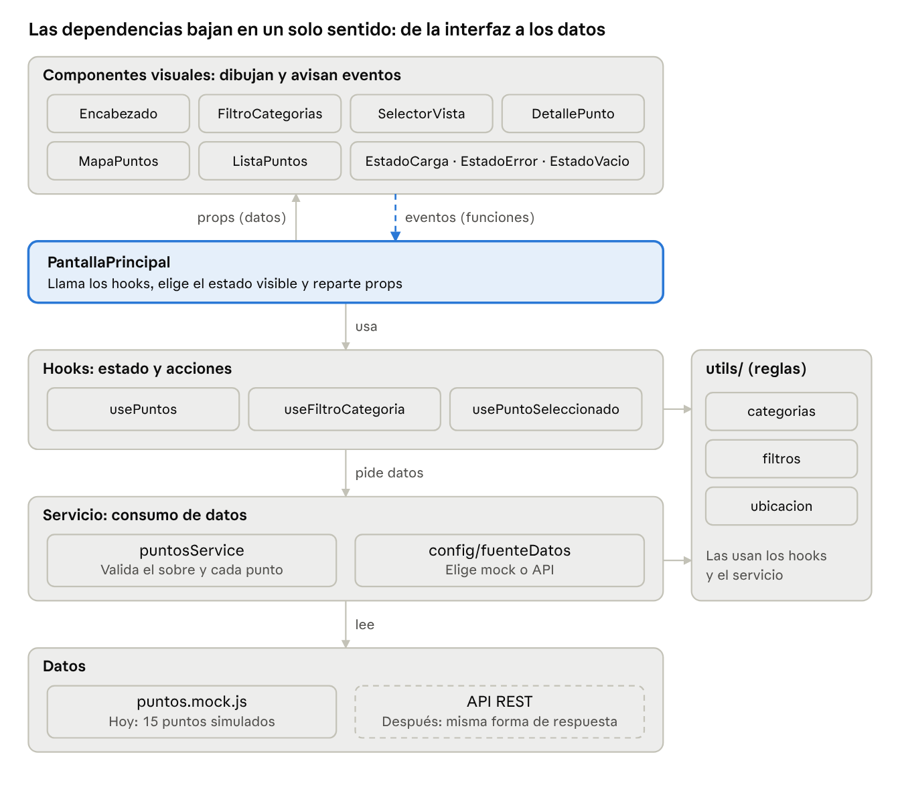
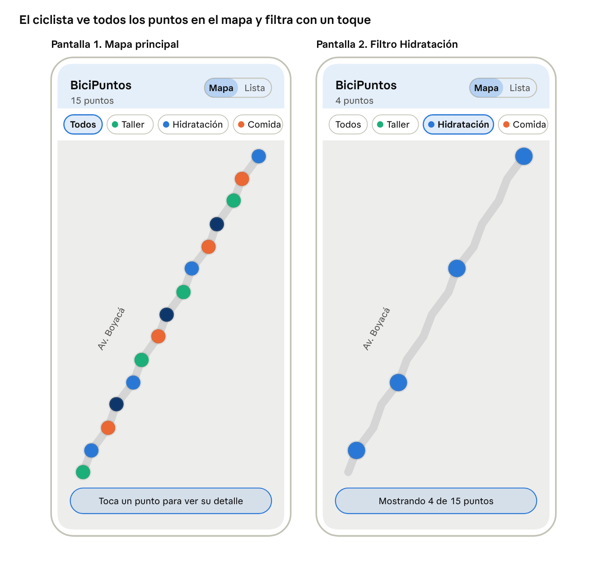

# Evidencia 2 · BiciPuntos: del dato a la arquitectura

Taller **"Del dato a la arquitectura de una aplicación móvil"**. Tecnólogo en Análisis y Desarrollo
de Software (ADSO), SENA, VI trimestre.

**Regla principal del taller: NO PROGRAMAR.** Este repositorio no tiene código de la app. Entrega
el análisis y el diseño técnico de **BiciPuntos**, una app móvil (React Native + Expo) para que
los ciclistas de la Avenida Boyacá encuentren talleres, puntos de hidratación, comida e
información. Todo parte del archivo [`puntos.mock.js`](materia-prima/puntos.mock.js), y el objetivo
es que otro desarrollador pueda construir la app sin inventar procesos ni estructura.

📄 **Documento completo: [ANALISIS_Y_DISENO.md](ANALISIS_Y_DISENO.md)** · también en
**[Word](BiciPuntos_Analisis_y_Diseno.docx)** (37 páginas, con diagramas y mockups)

## Dónde está cada entregable

| # | Entregable de la guía | Sección del documento | Diagramas |
|---|---|---|---|
| 1 | Análisis de `puntos.mock.js` y diccionario de datos | 1 | — |
| 2 | Requerimientos funcionales (13) y no funcionales (7) | 2 | — |
| 3 | Arquitectura propuesta | 3 | [Arquitectura general](diagramas/01-arquitectura-general.png) |
| 4 | Estructura de carpetas y responsabilidades | 3 y 3.1 | [Capa de consumo](diagramas/02-capa-de-consumo.png) |
| 5 | Inventario de hooks | 3.2 | — |
| 6 | Inventario de componentes y árbol jerárquico | 3.3 | [Árbol de componentes](diagramas/03-arbol-de-componentes.png) |
| 7 | Comunicación padre-hijo e hijo-padre | 4 | [Escenario A](diagramas/04-escenario-a-15-puntos.png), [Escenario B](diagramas/05-escenario-b-secuencia-punto-7.png), [Escenario C](diagramas/06-escenario-c-filtro-hidratacion.png) |
| 8 | Lógica de negocio y reglas de validación | 5 | [Flujo de consulta](diagramas/07-flujo-de-consulta.png), [Flujo de filtrado](diagramas/08-flujo-de-filtrado.png) |
| 9 | Diagramas de procesos y secuencias | 4, 5 y 7 | [Estados](diagramas/12-diagrama-de-estados.png), [Navegación](diagramas/13-flujo-de-navegacion.png) |
| 10 | Mockups de las pantallas principales | 6 | [Mapa y filtro](diagramas/09-mockups-mapa-y-filtro.png), [Detalle y sin resultados](diagramas/10-mockups-detalle-y-sin-resultados.png), [Carga, error y lista](diagramas/11-mockups-carga-error-lista.png) |
| 11 | MVP y matriz MoSCoW | 8 | — |
| 12 | Plan de implementación por etapas | 9 | — |

La sección 10 del documento es la **reflexión final individual**, con las respuestas a las 7
preguntas de la guía.

## Vista previa

**Arquitectura general**



**Mockups: mapa principal y filtro Hidratación**



## Decisiones principales

- **Una sola pantalla** con vistas y estados (mapa o lista, panel de detalle, carga, error y sin
  resultados), para que el ciclista nunca pierda el mapa de vista.
- **Tres capas separadas:** un servicio (`puntosService`) que valida los datos, tres hooks
  (`usePuntos`, `useFiltroCategoria`, `usePuntoSeleccionado`) que guardan el estado, y 14
  componentes que solo dibujan y avisan eventos.
- **La selección viaja como `id`**, y el objeto completo se busca en la colección original.
- **Filtrar nunca modifica la colección original:** siempre crea una colección nueva.
- **Cambiar el mock por una API real** solo afecta al servicio y a su configuración.

## Estructura del repositorio

```
Evidencia2_BiciPuntos/
├── README.md                 Este índice
├── ANALISIS_Y_DISENO.md      El documento completo de análisis y diseño
├── BiciPuntos_Analisis_y_Diseno.docx   El mismo documento en Word
├── diagramas/                13 diagramas y mockups en PNG
├── materia-prima/
│   └── puntos.mock.js        Archivo entregado por el instructor (sin cambios)
└── guia/
    └── Del_dato_a_la_arquitectura_de_una_aplicacion_movil.pdf   Guía del taller
```
